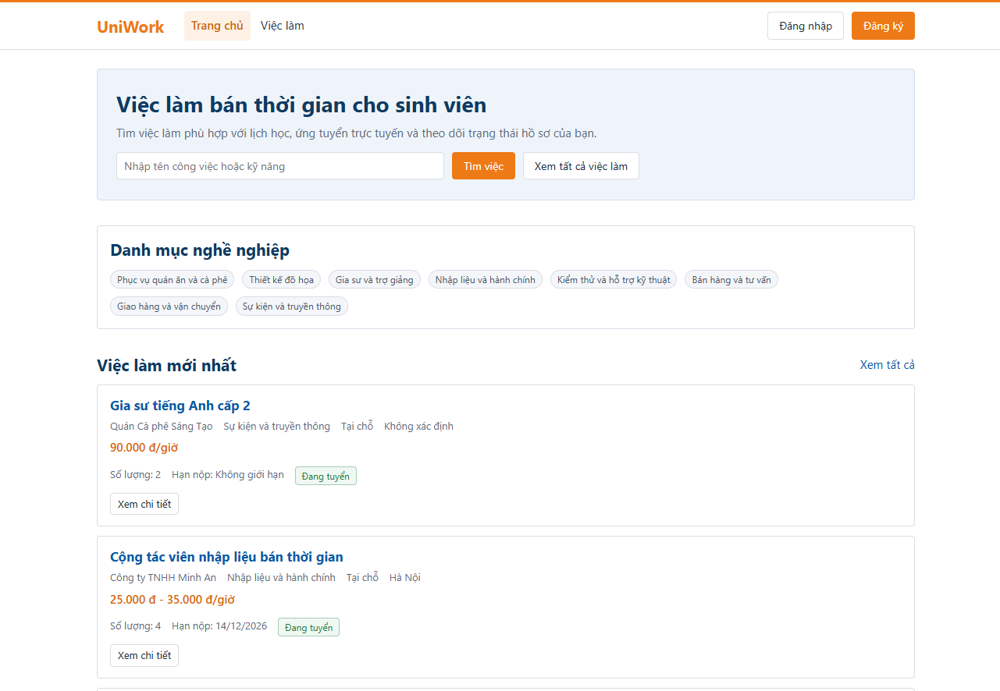
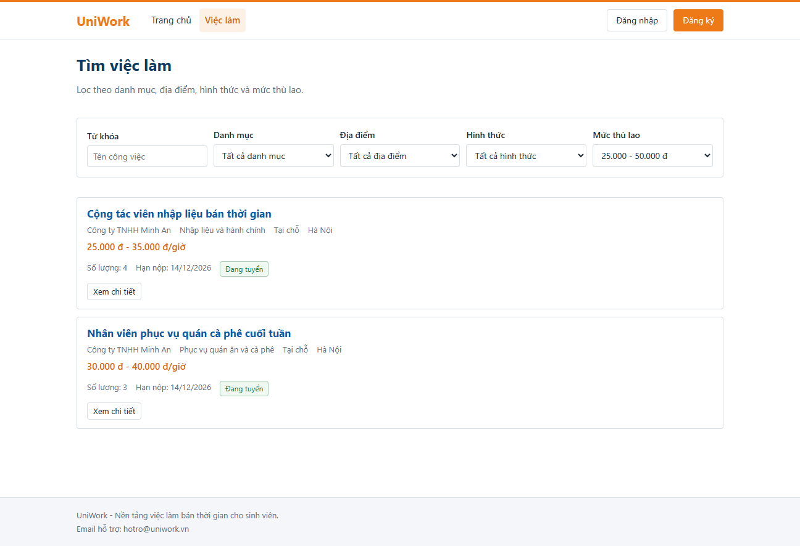

# UniWork Marketplace

Nền tảng web kết nối việc làm bán thời gian giữa sinh viên và nhà tuyển dụng. Sinh viên tìm việc, nộp hồ sơ, theo dõi đơn ứng tuyển và đánh giá nhà tuyển dụng; nhà tuyển dụng đăng tin, duyệt hồ sơ, quản lý tiến độ công việc; quản trị viên kiểm duyệt tin đăng, quản lý người dùng và danh mục ngành nghề.

Hệ thống gồm hai phần chạy độc lập trong cùng repo:

- `backend/`: REST API Spring Boot, xác thực JWT, phân quyền theo vai trò, dữ liệu MySQL.
- `app/`: giao diện React single-page, gọi API qua axios.





## 1. Trang web dành cho ai

| Vai trò | Có thể làm gì |
|---|---|
| Khách (chưa đăng nhập) | Xem trang chủ, tìm và lọc việc làm, xem chi tiết tin, xem thông tin và điểm uy tín nhà tuyển dụng, đăng ký, đăng nhập |
| Sinh viên (`STUDENT`) | Cập nhật hồ sơ cá nhân và kỹ năng, quản lý nhiều CV, nộp đơn ứng tuyển, rút đơn khi còn chờ, theo dõi trạng thái đơn, lưu tin việc làm, nhận thông báo, đánh giá nhà tuyển dụng sau khi hoàn thành công việc |
| Nhà tuyển dụng (`EMPLOYER`) | Cập nhật hồ sơ đơn vị, đăng tin kèm ca làm việc theo tuần, sửa tin, đóng tin, xem danh sách ứng viên, duyệt hoặc từ chối, đánh dấu bắt đầu và hoàn thành công việc, đánh giá sinh viên |
| Quản trị viên (`ADMIN`) | Xem bảng điều khiển, khóa/mở khóa/xóa tài khoản kèm lý do, ẩn hoặc hiện tin vi phạm, thêm và sửa danh mục ngành nghề, xem nhật ký thao tác |

## 2. Chức năng chính

### Tài khoản và xác thực email

- Đăng ký bằng email và mật khẩu, chọn vai trò sinh viên hoặc nhà tuyển dụng.
- Hệ thống gửi email chứa liên kết xác thực, hiệu lực 24 giờ. Tài khoản chỉ được kích hoạt sau khi bấm liên kết.
- Chưa xác thực thì đăng nhập bị chặn với thông báo gửi lại email; trang đăng ký và đăng nhập đều có nút gửi lại, giới hạn 60 giây mỗi lần.
- Sau khi xác thực, đăng nhập chỉ cần email và mật khẩu, không cần xác thực lại.
- Đăng nhập bằng Google được xem là email đã xác thực.

### Tìm việc và xem tin

- Tìm theo từ khóa trong tiêu đề, mô tả và yêu cầu công việc.
- Lọc theo danh mục, tỉnh thành, hình thức làm việc (tại chỗ, từ xa, kết hợp) và mức thù lao.
- Phân trang 10 tin mỗi trang.
- Chỉ hiển thị tin đang tuyển, chưa bị xóa, chưa quá hạn nộp và thuộc nhà tuyển dụng đang hoạt động.
- Trang chi tiết hiển thị mô tả, yêu cầu, quyền lợi, kỹ năng, ca làm việc, mức lương, hạn nộp, số lượng tuyển, thông tin đơn vị và điểm uy tín.

### Ứng tuyển

- Nộp đơn bằng CV đã lưu hoặc nhập đường dẫn CV mới, kèm thư giới thiệu và mức lương mong muốn.
- Chặn nộp trùng một tin, chặn nộp khi tin đã đóng, đã hết hạn hoặc khi nhà tuyển dụng không còn hoạt động.
- Trạng thái đơn: `PENDING` (chờ duyệt), `ACCEPTED` (được nhận), `REJECTED` (từ chối), `COMPLETED` (hoàn thành), `WITHDRAWN` (sinh viên rút).
- Mỗi lần đổi trạng thái đều ghi lịch sử và tạo thông báo cho bên liên quan.

### Đánh giá hai chiều

- Chỉ đánh giá được khi đơn ứng tuyển đã ở trạng thái `COMPLETED`.
- Mỗi đơn chỉ đánh giá một lần, không tự đánh giá chính mình, điểm từ 1 đến 5, nhận xét tối đa 500 ký tự.
- Điểm uy tín trung bình được tính lại sau mỗi đánh giá và hiển thị công khai trên tin tuyển dụng và hồ sơ nhà tuyển dụng.

### Thông báo

- Thông báo trong ứng dụng khi có đơn mới, đơn được duyệt hoặc từ chối, đơn bị rút, công việc bắt đầu hoặc hoàn thành, có đánh giá mới, tài khoản bị khóa.
- Đếm số chưa đọc trên thanh điều hướng, lọc chỉ xem chưa đọc, đánh dấu đã đọc từng thông báo hoặc tất cả.

### Quản trị

- Khóa, mở khóa, xóa mềm tài khoản; bắt buộc nhập lý do khi khóa hoặc xóa và không cho tự khóa chính mình.
- Ẩn hoặc hiện tin tuyển dụng vi phạm.
- Thêm danh mục, sửa tên và mô tả, ẩn danh mục khỏi bộ lọc.
- Xem nhật ký thao tác quản trị.

## 3. Các trang trong giao diện

| Đường dẫn | Trang | Quyền truy cập |
|---|---|---|
| `/` | Trang chủ, giới thiệu và tin nổi bật | Công khai |
| `/jobs` | Danh sách việc làm và bộ lọc | Công khai |
| `/jobs/:id` | Chi tiết tin và form ứng tuyển | Công khai |
| `/login`, `/register` | Đăng nhập, đăng ký | Công khai |
| `/profile` | Hồ sơ cá nhân, kỹ năng, CV | Đã đăng nhập |
| `/student/applications` | Danh sách đơn đã nộp | Sinh viên |
| `/student/applications/:id` | Chi tiết đơn, rút đơn | Sinh viên |
| `/student/saved-jobs` | Việc làm đã lưu | Sinh viên |
| `/employer/jobs` | Tin đã đăng | Nhà tuyển dụng |
| `/employer/jobs/new`, `/employer/jobs/:id/edit` | Đăng và sửa tin | Nhà tuyển dụng |
| `/employer/jobs/:id` | Chi tiết tin và danh sách ứng viên | Nhà tuyển dụng |
| `/employer/applications/:id` | Xử lý đơn ứng tuyển | Nhà tuyển dụng |
| `/notifications` | Thông báo | Đã đăng nhập |
| `/reviews` | Đánh giá của tôi và đánh giá chờ xử lý | Đã đăng nhập |
| `/admin` | Bảng điều khiển | Quản trị viên |
| `/admin/users` | Quản lý người dùng | Quản trị viên |
| `/admin/jobs` | Kiểm duyệt tin đăng | Quản trị viên |
| `/admin/categories` | Quản lý danh mục | Quản trị viên |

Giao diện tiếng Việt, bố cục phẳng, tông cam `#ee7a17` và xanh `#0f3a63`, không dùng thư viện UI ngoài.

## 4. Công nghệ

| Thành phần | Công nghệ |
|---|---|
| Backend | Java 17, Spring Boot 3.3.5, Spring Web, Spring Security, Spring Data JPA, Bean Validation, Lombok |
| Xác thực | JWT HMAC-SHA256, hạn 24 giờ, mật khẩu băm BCrypt, phân quyền `STUDENT` / `EMPLOYER` / `ADMIN` |
| Cơ sở dữ liệu | MySQL 8, Flyway quản lý migration, Hibernate kiểm tra schema ở chế độ `validate` |
| Tài liệu API | springdoc OpenAPI tại `/swagger-ui.html` |
| Frontend | React 19, TypeScript, Vite 6, react-router 7, axios, CSS thuần |
| Kiểm thử | JUnit 5, Mockito, Spring Boot Test (28 unit test) |

## 5. Cấu trúc thư mục

```text
uniwork-marketplace/
├── backend/
│   ├── src/main/java/com/uniwork/
│   │   ├── config/         # Bảo mật, CORS, dữ liệu mẫu
│   │   ├── controller/     # REST controller
│   │   ├── dto/            # Request/response DTO
│   │   ├── entity/         # Thực thể JPA
│   │   ├── repository/     # Truy vấn dữ liệu, specification
│   │   ├── security/       # JWT filter, phân quyền
│   │   └── service/        # Nghiệp vụ
│   ├── src/main/resources/
│   │   ├── application.yml
│   │   └── db/migration/V1__init_schema.sql
│   └── src/test/java/com/uniwork/    # Unit test
├── app/
│   ├── src/
│   │   ├── pages/          # 18 trang theo vai trò
│   │   ├── components/     # Layout, thẻ tin, phân trang
│   │   ├── api.ts          # Cấu hình axios và xử lý lỗi
│   │   ├── auth.tsx        # Quản lý phiên đăng nhập
│   │   ├── format.ts       # Định dạng tiền, ngày, trạng thái
│   │   └── index.css       # Bảng màu và bố cục
│   └── package.json
├── docs/screenshots/       # Ảnh giao diện dùng trong README
└── README.md
```

## 6. Chạy dự án

### Yêu cầu

- JDK 17
- Node.js 20 trở lên
- MySQL 8 đang chạy

### 6.1. Chuẩn bị cơ sở dữ liệu

Tạo database và tài khoản:

```sql
CREATE DATABASE uniwork CHARACTER SET utf8mb4 COLLATE utf8mb4_unicode_ci;
CREATE USER 'uniwork'@'localhost' IDENTIFIED BY 'uniwork123';
GRANT ALL PRIVILEGES ON uniwork.* TO 'uniwork'@'localhost';
FLUSH PRIVILEGES;
```

Nếu MySQL bật binary log, cần cho phép tạo trigger tính điểm đánh giá:

```sql
SET GLOBAL log_bin_trust_function_creators = 1;
```

Flyway tự chạy `V1__init_schema.sql` khi backend khởi động lần đầu, không cần import thủ công.

### 6.2. Chạy backend

Windows:

```powershell
cd backend
$env:DB_URL="jdbc:mysql://localhost:3306/uniwork?useSSL=false&serverTimezone=UTC&characterEncoding=UTF-8&allowPublicKeyRetrieval=true"
$env:DB_USERNAME="uniwork"
$env:DB_PASSWORD="uniwork123"
$env:DEMO_DATA_ENABLED="true"
$env:MAIL_USERNAME="your-email@gmail.com"
$env:MAIL_PASSWORD="your-gmail-app-password"
$env:APP_BASE_URL="http://localhost:8080"
.\mvnw.cmd spring-boot:run
```

macOS/Linux:

```bash
cd backend
export DB_URL="jdbc:mysql://localhost:3306/uniwork?useSSL=false&serverTimezone=UTC&characterEncoding=UTF-8&allowPublicKeyRetrieval=true"
export DB_USERNAME=uniwork
export DB_PASSWORD=uniwork123
export DEMO_DATA_ENABLED=true
export MAIL_USERNAME=your-email@gmail.com
export MAIL_PASSWORD=your-gmail-app-password
export APP_BASE_URL=http://localhost:8080
./mvnw spring-boot:run
```

Nếu chưa có Gmail App Password, có thể bỏ qua hai biến `MAIL_*`; liên kết xác thực sẽ được ghi ra log backend để dùng tạm khi phát triển.

Backend chạy tại `http://localhost:8080`, Swagger UI tại `http://localhost:8080/swagger-ui.html`.

Đóng gói file jar:

```powershell
cd backend
.\mvnw.cmd package
java -jar target\uniwork-backend-0.0.1-SNAPSHOT.jar
```

### 6.3. Chạy frontend

```bash
cd app
npm install
npm run dev
```

Giao diện chạy tại `http://localhost:5173`. Mặc định gọi API `http://localhost:8080/api/v1`; đổi bằng biến `VITE_API_URL` trong file `app/.env` hoặc biến môi trường khi build.

Build bản tĩnh:

```bash
cd app
npm run build
```

Kết quả ở `app/dist/`.

## 7. Tài khoản demo

Khi `DEMO_DATA_ENABLED=true` và database còn trống, hệ thống tự tạo dữ liệu mẫu:

| Vai trò | Email | Mật khẩu |
|---|---|---|
| Quản trị viên | `admin@uniwork.vn` | `Admin@123` |
| Sinh viên | `student@uniwork.vn` | `Student@123` |
| Sinh viên | `student2@uniwork.vn` | `Student@123` |
| Nhà tuyển dụng | `employer@uniwork.vn` | `Employer@123` |
| Nhà tuyển dụng | `employer2@uniwork.vn` | `Employer@123` |

Danh sách đầy đủ kèm ghi chú nằm trong `docs/tai-khoan-demo.txt`.

Tài khoản admin lấy từ `ADMIN_INITIAL_EMAIL` và `ADMIN_INITIAL_PASSWORD`; nếu để trống thì bỏ qua bước tạo admin.

## 8. Biến môi trường

| Biến | Mặc định | Ý nghĩa |
|---|---|---|
| `DB_URL` | `jdbc:mysql://localhost:3306/parttime_marketplace?...` | Chuỗi kết nối MySQL |
| `DB_USERNAME` | `root` | Tài khoản database |
| `DB_PASSWORD` | `root` | Mật khẩu database |
| `JWT_SECRET` | khóa mẫu trong `application.yml` | Khóa ký JWT, phải đổi khi triển khai thật |
| `JWT_EXPIRATION_MS` | `86400000` | Thời hạn token, 24 giờ |
| `EMAIL_VERIFICATION_REQUIRED` | `true` | Bắt buộc xác thực email trước khi đăng nhập |
| `DEMO_DATA_ENABLED` | `true` | Tạo dữ liệu mẫu khi database trống |
| `MAIL_HOST`, `MAIL_PORT` | `smtp.gmail.com`, `587` | Máy chủ gửi mail |
| `MAIL_USERNAME`, `MAIL_PASSWORD` | rỗng | Tài khoản Gmail và App Password để gửi mail |
| `APP_MAIL_FROM` | `UniWork Marketplace <no-reply@uniwork.vn>` | Tên và địa chỉ người gửi |
| `APP_BASE_URL` | `http://localhost:8080` | Gốc URL dùng trong link xác thực email |
| `GOOGLE_CLIENT_ID` | giá trị mẫu | Client ID cho đăng nhập Google |
| `ADMIN_INITIAL_EMAIL`, `ADMIN_INITIAL_PASSWORD` | `admin@uniwork.vn`, `admin123456` | Tài khoản quản trị tạo lần đầu |
| `CORS_ALLOWED_ORIGINS` | `http://localhost:5173,...` | Danh sách origin được gọi API |
| `VITE_API_URL` | `http://localhost:8080/api/v1` | Địa chỉ API phía frontend |

Ghi chú:

- Mặc định bật xác thực email: sau khi đăng ký, tài khoản ở trạng thái chờ xác thực và chỉ đăng nhập được sau khi bấm liên kết trong email. Đăng nhập về sau chỉ cần email và mật khẩu, không cần xác thực lại.
- Để gửi email thật, điền `MAIL_USERNAME` và `MAIL_PASSWORD` (Gmail App Password), đồng thời đặt `APP_BASE_URL` đúng để link xác thực trỏ về backend.
- Nếu chưa cấu hình `MAIL_USERNAME`, hệ thống không gửi mail mà ghi liên kết xác thực ra log backend với mức `WARN`, dùng được khi chạy cục bộ.
- Đăng nhập Google chỉ hoạt động khi thay `GOOGLE_CLIENT_ID` bằng Client ID thật từ Google Cloud Console.

## 9. Luồng nghiệp vụ chính

```text
Nhà tuyển dụng đăng tin (OPEN)
        |
Sinh viên nộp đơn (PENDING)
        |
Nhà tuyển dụng duyệt (ACCEPTED) hoặc từ chối (REJECTED)
        |
Sinh viên có thể rút khi đơn còn PENDING (WITHDRAWN)
        |
Nhà tuyển dụng đánh dấu bắt đầu, sau đó hoàn thành (COMPLETED)
        |
Hai bên đánh giá 1-5 sao, điểm uy tín được tính lại
```

Quy tắc nghiệp vụ đáng chú ý:

- Tin phải có mức lương tối thiểu lớn hơn 0, trừ hình thức thỏa thuận (`NEGOTIABLE`).
- Hạn nộp không được trước ngày hiện tại.
- Ca làm việc có thứ từ 1 đến 7, giờ bắt đầu phải trước giờ kết thúc.
- Không thể thay đổi trạng thái tài khoản của chính quản trị viên đang đăng nhập.
- Danh mục và tin bị ẩn không xuất hiện trong kết quả tìm kiếm công khai.

## 10. API chính

Tất cả endpoint nằm dưới `/api/v1`, phản hồi bọc trong `{ "success", "message", "data" }`.

| Nhóm | Endpoint tiêu biểu |
|---|---|
| Xác thực | `POST /auth/register`, `POST /auth/login`, `POST /auth/google`, `GET /auth/me`, `GET /auth/verify-email`, `POST /auth/resend-verification` |
| Hồ sơ | `GET /profiles/me`, `PUT /profiles/me` |
| CV | `GET/POST /student/resumes`, `PUT/DELETE /student/resumes/{id}` |
| Việc làm công khai | `GET /jobs`, `GET /jobs/{id}` |
| Tin của nhà tuyển dụng | `GET/POST /employer/jobs`, `GET/PUT /employer/jobs/{id}`, `PATCH /employer/jobs/{id}/close` |
| Ứng tuyển | `POST /jobs/{jobId}/applications`, `GET /student/applications`, `PATCH /student/applications/{id}/withdraw`, `GET /employer/jobs/{jobId}/applications`, `PATCH /employer/applications/{id}/status` |
| Đánh giá | `POST /reviews`, `GET /reviews`, `GET /reviews/pending` |
| Thông báo | `GET /notifications`, `GET /notifications/unread-count`, `PATCH /notifications/{id}/read`, `PATCH /notifications/read-all` |
| Việc đã lưu | `GET /student/saved-jobs`, `POST /student/saved-jobs/{jobId}`, `DELETE /student/saved-jobs/{jobId}` |
| Dữ liệu chung | `GET /categories`, `GET /public/provinces`, `GET /public/skills` |
| Quản trị | `GET /admin/dashboard`, `GET/PATCH /admin/users`, `GET /admin/jobs`, `PATCH /admin/jobs/{id}/visibility`, `GET/POST/PUT /admin/categories`, `GET /admin/audit-logs` |

Xem đầy đủ tham số và mã lỗi tại Swagger UI sau khi chạy backend.

## 11. Kiểm thử và trạng thái

- Chạy test backend: `cd backend` rồi `.\mvnw.cmd test` (Windows) hoặc `./mvnw test`. Hiện có 28 test, tất cả đạt.
- Build frontend: `cd app` rồi `npm run build`.
- Đã kiểm tra thủ công các luồng đăng ký, đăng nhập, đăng tin, ứng tuyển, duyệt đơn, hoàn thành, đánh giá, thông báo và quản trị trên dữ liệu mẫu.

Phần chưa triển khai trong phạm vi đồ án:

- Gửi mail thật và đăng nhập Google cần tài khoản SMTP và Client ID thật.
- Chưa có bộ Postman Collection chính thức; kiểm thử API thực hiện qua Swagger UI và script thủ công.
- Chưa đo hiệu năng tải và chưa triển khai lên máy chủ cloud; dự án chạy cục bộ.

## 12. Nhóm thực hiện

Đồ án Chuyên đề tốt nghiệp 2, Khoa Công nghệ Thông tin, Trường Đại học Văn Lang, HK1 2026-2027.

- Nguyễn Nam Khánh
- Phạm Trí Trọng
- Nguyễn Trần Hoàng Vinh

Giảng viên hướng dẫn: ThS. Nguyễn Văn Trung.
