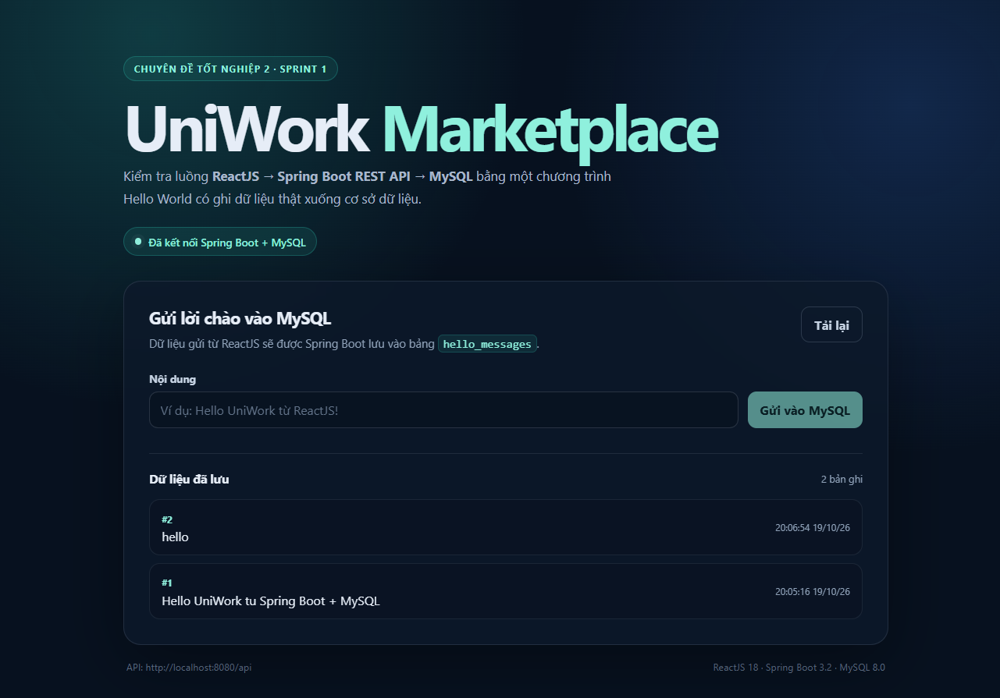

# Kết quả chạy thử Hello World

- **Ngày kiểm thử:** 19/10/2026
- **Mục tiêu:** Xác nhận môi trường phát triển và luồng `ReactJS → Spring Boot REST API → MySQL` hoạt động.
- **Người thực hiện:** Nhóm UniWork

## 1. Môi trường kiểm thử

| Thành phần | Phiên bản |
|---|---|
| JDK | 24.0.1 (compile target Java 21) |
| Node.js | 24.16.0 |
| npm | 11.17.0 |
| MySQL | 8.0.46 |
| Spring Boot | 3.2.12 |
| ReactJS | 18.3.1 |
| Vite | 5.4.21 |

## 2. Kết quả kiểm thử backend

Chạy:

```bash
cd backend
.\mvnw.cmd test
```

Kết quả:

- `UniworkBackendApplicationTests` – pass
- `HelloControllerTest` – pass
- Tổng: **2 test pass**, dùng H2 in-memory cho kiểm thử tự động.

## 3. Kết quả build frontend

Chạy:

```bash
cd frontend
npm run build
```

Kết quả:

- Build thành công.
- 31 module được xử lý.
- File build nằm trong `frontend/dist/`.

## 4. Kết quả kiểm thử API với MySQL

- **Database:** `uniwork`
- **Bảng:** `hello_messages`

| Kiểm tra | Kết quả |
|---|---|
| `GET /api/hello/ping` | Thành công, trả về trạng thái backend và số bản ghi |
| `POST /api/hello` | Thành công, lưu bản ghi vào MySQL |
| `GET /api/hello` | Thành công, trả về danh sách bản ghi |
| CORS `OPTIONS` từ `http://localhost:5173` | Thành công, trả về `Access-Control-Allow-Origin` |

Dữ liệu đã ghi nhận trong MySQL:

```text
id | content                                      | created_at
1  | Hello UniWork tu Spring Boot + MySQL         | 2026-10-19 13:05:16
```

## 5. Kết quả trên giao diện ReactJS

- Giao diện hiển thị trạng thái: **Đã kết nối Spring Boot + MySQL**.
- Danh sách hiển thị dữ liệu lấy từ MySQL.
- Chức năng gửi lời chào mới hoạt động và dữ liệu được ghi nhận vào CSDL.



## 6. Kết luận

Môi trường phát triển đã sẵn sàng. Luồng ReactJS gọi REST API Spring Boot và ghi dữ liệu thành công xuống MySQL đã được kiểm chứng, đủ điều kiện chuyển sang xây dựng các chức năng nghiệp vụ ở Sprint 2.
